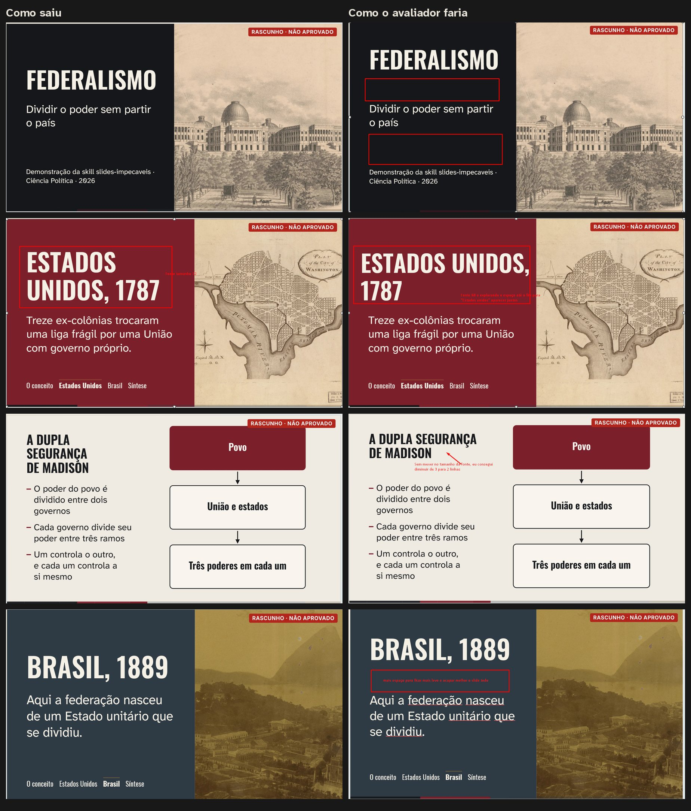
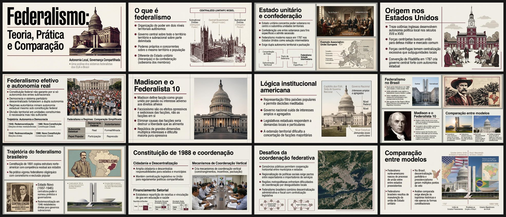
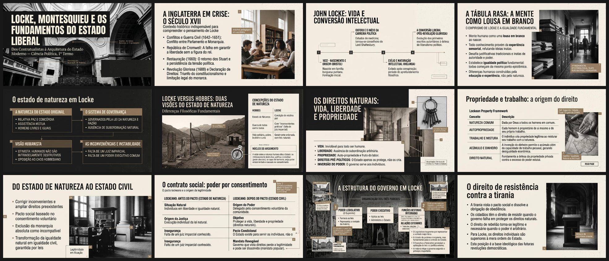
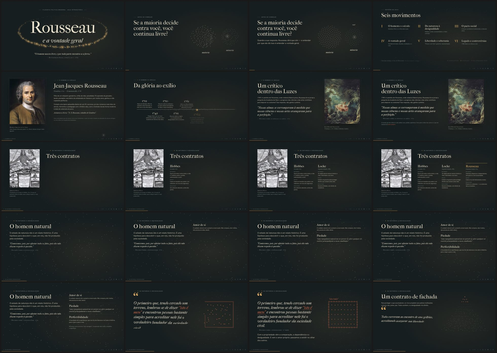
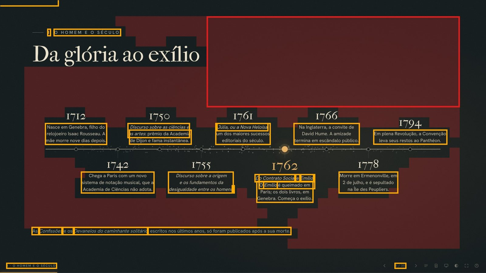
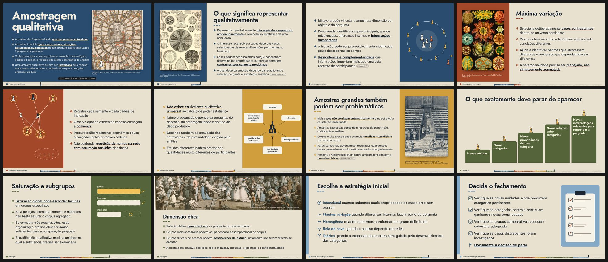
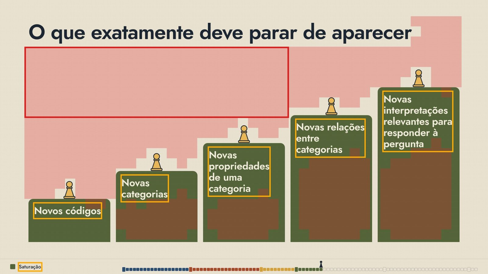
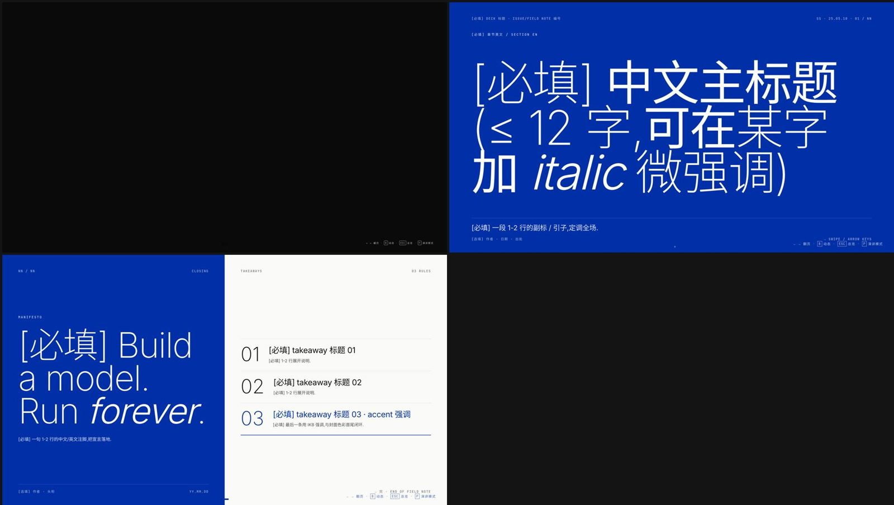

# Exemplos visuais

Olhe estas imagens antes de montar um deck. Elas mostram o padrão que a skill exige e os defeitos que ela proíbe.

## O padrão a seguir

### Os mesmos slides nos dezessete temas
Folhas com capa, slide dividido com documento de acervo e citação, nos dezessete temas. Desse jeito a porta G3 apresenta a escolha do tema à pessoa. As folhas não acompanham o pacote, porque a skill as gera de novo a cada uso: `python3 scripts/amostra_temas.py exemplos/federalismo --todos` escreve `temas_1.jpg` a `temas_3.jpg` em `federalismo/amostra-temas/`.

### Deck completo, `federalismo/`
19 slides em `editorial`, com gravuras e mapas da Library of Congress e fotografias da NASA, todos com crédito na tecla I e sem texto por cima, salvo a galeria, em que a legenda foi pedida. Passou em todas as medições. Para não pesar a skill, o pacote traz só as fontes do deck: `deck.json` e as imagens com crédito.

- `python3 scripts/fazer.py exemplos/federalismo` constrói, aprova e exporta: `dist/federalismo.html` abre em qualquer navegador, sem internet; `verificacao/folhas/folha_01.jpg` a `folha_03.jpg` são as folhas de contato com os números de cada slide; `verificacao/slides/sNNN_marcas.jpg` mostram vazio em vermelho e texto pequeno em laranja (quando há).
- `python3 scripts/revisao.py exemplos/federalismo` gera o painel do avaliador humano em `federalismo/revisao/painel.html`.
- `python3 scripts/exportar_pdf.py exemplos/federalismo` e `python3 scripts/exportar_pptx.py exemplos/federalismo` geram as exportações de revisão. Com `--conferir` no exportar_pptx, `verificacao/pptx/html_x_pptx.jpg` compara o HTML com o PPTX renderizado no LibreOffice.

O que copiar deste deck.
- Capa com campo de cor e imagem sangrando. Título enorme, uma linha de subtítulo.
- Um momento forte a cada poucos slides (pergunta, número, citação, imagem em tela cheia, tese).
- Linha do tempo com a imagem da época em faixa.
- Gráfico com o caso em discussão destacado. A fonte vai para a tecla I.
- Referência curta no texto quando preciso, como "(Riker, 1964)".
- Imagens limpas, sem legenda nem fonte por cima. Legenda só onde a pessoa pediu (galeria).

### Catálogo de layouts, `catalogo-layouts/`
Os vinte layouts e o modo livre em `tabuleiro`, um por slide. Use para ver o que cada layout faz e quais campos ele pede (`catalogo-layouts/deck.json`). As folhas de contato saem com `python3 scripts/fazer.py exemplos/catalogo-layouts --sem-exportar`.

### Bom senso com o espaço, `referencias/espaco-antes-depois.jpg`
Quatro slides do exemplo como saíram e como o avaliador humano os refez. Título com menos linhas usando a largura da coluna, nome composto inteiro, respiro entre título e texto, capa com os blocos distribuídos na altura. As regras estão em `../references/03-direcao-de-arte.md`.

## Decks de referência, o que copiar e o que evitar

As imagens estão em `referencias/`. As medições estão em `../references/13-licoes-das-skills-anteriores.md`.

### `referencias/federalismo-pdf.jpg` e `referencias/locke-pdf.jpg`
PDFs exportados do PowerPoint em que cada slide é uma imagem só.

Copiar. Tela sempre cheia. Imagem em quase todo slide. Títulos grandes e condensados. Paleta creme, grafite e um acento. Composição que muda a cada slide (colagem, tabela, linha do tempo, grade de imagens, mapa).

Evitar. Texto dentro da imagem (não edita, não busca, não lê em voz alta, não mede). Imagens geradas com rótulos inventados ("Pai da Nação 1", "Representante 2") e diagrama em inglês num deck em português. Rótulos e anotações miúdos espalhados pelas colagens.

### `referencias/rousseau.jpg` e `referencias/marcas-rousseau.jpg`
Deck HTML com a melhor direção de arte e o melhor movimento do conjunto.

Copiar. Obras reais com legenda de museu. Partículas que significam algo. Argumento revelado em etapas. Notas do apresentador com tempo.

Evitar. Corpo mediano de 24 px e rótulos de 12 a 15 px. Metade da tela escura e vazia em 83 de 90 passos. Rótulo pequeno em caixa alta acima do título. Na imagem com marcas, o vermelho é a área morta e o laranja é o texto abaixo do piso.

### `referencias/aula-html-slides.jpg` e `referencias/marcas-aula.jpg`
Exemplo de 101 slides da skill aula-html-slides.

Copiar. Temas como mundos visuais completos. Imagens de acervo com crédito. Ilustrações e diagramas desenhados no tema.

Evitar. Legendas, chips, nome do bloco e trilha abaixo de 28 px em todos os slides. Corpo abaixo de 44 px em 32 slides. Faixas vazias acima de blocos de cor (20 telas com área morta acima do limite).

### `referencias/templates-slides-rafael.jpg`
Os dois modelos HTML da skill-slides-rafael renderizados no Chromium.

Evitar. Modelo que abre como tela preta. Marcadores de texto a preencher em chinês. Rótulos em monoespaçada de 10 a 14 px. Numeração 01, 02, 03 decorativa.

